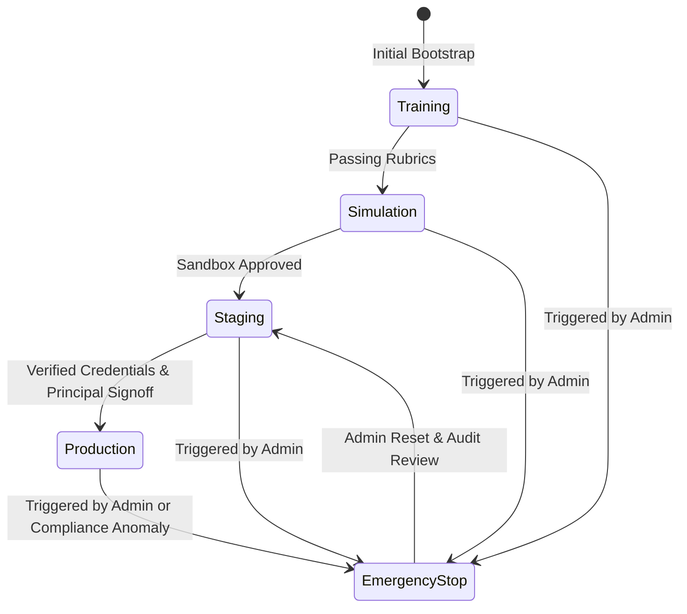

# Michelle Rogers Executive Intelligence — Technical Architecture
**Document ID:** MR-ARCH-001  
**System:** Executive Intelligence System (EIS)  
**Target Platform:** Cloudflare Workers / Supabase PostgreSQL / React 18  

---

## 1. System Architecture Overview

Michelle Rogers is architected as a decoupled, multi-tiered enterprise intelligence application designed for high availability, zero hallucination on corporate records, and strict regulatory compliance.

```
┌────────────────────────────────────────────────────────────────────────┐
│                          PRESENTATION TIER                             │
│                                                                        │
│   ┌──────────────────────────────────┐ ┌───────────────────────────┐  │
│   │ Executive Command Center         │ │ Investor Meeting Room     │  │
│   │ (14 Tabs, Admin Authed)          │ │ (Token Gated, Public URL) │  │
│   └─────────────────┬────────────────┘ └─────────────┬─────────────┘  │
└─────────────────────┼────────────────────────────────┼─────────────────┘
                      │ HTTPS                          │ HTTPS
                      ▼                                ▼
┌────────────────────────────────────────────────────────────────────────┐
│                           API GATEWAY TIER                             │
│                      (Cloudflare Worker Runtime)                       │
│                                                                        │
│   • Request Routing: /api/executive/* & /api/investor-meeting/*        │
│   • Auth Verification: Supabase JWT & One-Time Cryptographic Tokens   │
│   • Deterministic Policy Gateway (Legal & Regulatory Guards)           │
│   • Minto Pyramid & Diplomatic Response Synthesizers                   │
└─────────────────────────────────────┬──────────────────────────────────┘
                                      │
                                      ▼
┌────────────────────────────────────────────────────────────────────────┐
│                        DATA & PERSISTENCE TIER                         │
│                    (Supabase PostgreSQL 16 Engine)                     │
│                                                                        │
│   ┌──────────────────────────┐         ┌──────────────────────────┐    │
│   │ Core CRM & Pipelines     │         │ Curricular Knowledge     │    │
│   │ • 24 Normalized Tables   │         │ • 30 Departments         │    │
│   │ • RLS: Deny-by-Default   │         │ • Sources & Rubrics      │    │
│   └─────────────┬────────────┘         └─────────────┬────────────┘    │
│                 │                                    │                 │
│                 ▼                                    ▼                 │
│   ┌───────────────────────────────────────────────────────────────┐    │
│   │ Immutable Audit Ledger (`mr_executive_audit_events`)          │    │
│   │ Enforced by DB Trigger: Block UPDATE / DELETE                 │    │
│   └───────────────────────────────────────────────────────────────┘    │
└────────────────────────────────────────────────────────────────────────┘
```

---

## 2. API Route Specifications

### Executive Management Endpoints (`/api/executive/*`)
- **`GET /api/executive/status`**
  - *Auth:* Verified Super-Admin Session
  - *Returns:* Operating mode, $450k goal metrics, pipeline counts, academy progress, emergency stop status.
- **`POST /api/executive/mode`**
  - *Auth:* Verified Super-Admin Session
  - *Body:* `{ mode: "training" | "simulation" | "staging" | "production" | "emergency_stop", reason: string }`
  - *Behavior:* Modifies global operational constraints and writes immutable audit event.
- **`GET /api/executive/investors`**
  - *Auth:* Verified Super-Admin Session
  - *Query Params:* `stage`, `minScore`, `status`
  - *Returns:* Qualified investor records with composite fit scores.
- **`POST /api/executive/investors/score`**
  - *Auth:* Verified Super-Admin Session
  - *Body:* Investor attribute object
  - *Returns:* 9-point criteria breakdown and weighted fit score (0-100).
- **`GET /api/executive/academy/departments`**
  - *Auth:* Verified Super-Admin Session
  - *Returns:* Roster of all 30 departments with competency status and module counts.
- **`GET /api/executive/dataroom/tree`**
  - *Auth:* Verified Super-Admin Session
  - *Returns:* 7-folder institutional tree with file manifests and NDA requirements.

### Investor Experience Endpoints (`/api/investor-meeting/*`)
- **`GET /api/investor-meeting/validate`**
  - *Auth:* Query parameter `?token=<access_token>`
  - *Returns:* Validated meeting agenda, host info, investor name, and presentation deck.
- **`POST /api/investor-meeting/log-event`**
  - *Auth:* Valid Token
  - *Body:* `{ event_type: string, payload: object }`
  - *Returns:* `{ ok: true, recorded: true }`

---

## 3. State Machine & Operating Modes

Michelle operates within an explicit state machine with five deterministic modes:



### Mode Capabilities Matrix
| Capability | Training | Simulation | Staging | Production | Emergency Stop |
| :--- | :---: | :---: | :---: | :---: | :---: |
| Read Academy Curricula | YES | YES | YES | YES | NO |
| Calculate Investor Scores | YES | YES | YES | YES | NO |
| Generate Draft Decks | YES | YES | YES | YES | NO |
| Send Outbound Email | NO | NO | SANDBOX ONLY | LIVE (WITH APPROVAL) | NO |
| Host Virtual Briefings | NO | SIMULATED | TEST ONLY | LIVE (TOKEN GATED) | NO |
| Database Mutations | LOCAL | MOCKED | STAGING DB | PROD DB | LOCKED |

---

## 4. Truth Classification Engine

To eliminate factual hallucinations, every statement generated by Michelle or stored in corporate records must be classified into one of four mutually exclusive categories:

1. **`verified_fact`:** Authenticated historical or operational data backed by verified bank statements, legal corporate documents, or published public records.
2. **`approved_plan`:** Officially ratified internal objectives, budgets, and roadmaps approved by the Board or Chief Executive.
3. **`projection_assumption`:** Mathematical forecasts, financial pro-formas, or scenario models clearly identified with underlying methodology and risk disclaimers.
4. **`unknown_unverified`:** Unsubstantiated claims, third-party rumors, or unconfirmed estimates. Michelle is **strictly prohibited** from representing these as fact.
